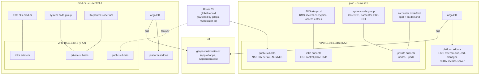
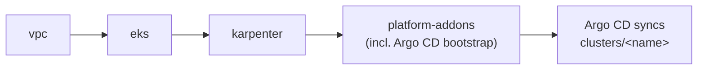

# terraform-aws-eks-platform

[](https://github.com/ozy31/terraform-aws-eks-platform/actions/workflows/ci.yml)


Terraform modules and a Terragrunt live layout for running production Amazon EKS
across two regions: a VPC, the cluster, Karpenter for compute, and the handful of
addons a cluster needs before GitOps takes over.

This is the layout I reach for when building an EKS platform from scratch. It wraps
the [terraform-aws-modules](https://github.com/terraform-aws-modules) community
modules (pinned) with opinionated defaults instead of re-implementing them, keeps
Terraform's job small (infrastructure + bootstrap), and hands everything that lives
inside the cluster to Argo CD.

> Account IDs, hosted zone IDs and role ARNs under `live/` are placeholders.

## Contents

- [Architecture](#architecture)
- [Modules](#modules)
- [Repository layout](#repository-layout)
- [Disaster recovery design](#disaster-recovery-design)
- [Cost notes](#cost-notes)
- [Usage](#usage)
- [Design decisions](#design-decisions)
- [Development](#development)
- [Module reference](#module-reference)

## Architecture



Provisioning order per environment (Terragrunt resolves it from `dependency` blocks):



## Modules

| Module | Wraps | What it adds |
|---|---|---|
| [`modules/vpc`](modules/vpc) | `terraform-aws-modules/vpc/aws` 6.7.3 | Fixed 3-AZ layout (private /19, public /24, intra /24), NAT per AZ with a single-NAT toggle, ELB and Karpenter discovery tags, flow logs, locked-down default SG. |
| [`modules/eks`](modules/eks) | `terraform-aws-modules/eks/aws` 21.29.0 | Access-entry-only auth, KMS secrets encryption, private endpoint by default, core managed addons (VPC CNI with prefix delegation, Pod Identity agent, CoreDNS, kube-proxy, EBS CSI), tainted system node group for critical pods. |
| [`modules/karpenter`](modules/karpenter) | `terraform-aws-modules/eks/aws//modules/karpenter` 21.29.0 + Karpenter Helm chart 1.15.0 | Pod Identity controller role, interruption queue, controller pinned to the system node group, default `EC2NodeClass` + `NodePool` (spot + on-demand, AL2023 or Bottlerocket). |
| [`modules/platform-addons`](modules/platform-addons) | `terraform-aws-modules/eks-pod-identity/aws` 2.10.0 + upstream Helm charts | AWS Load Balancer Controller, external-dns, cert-manager, KEDA, metrics-server, Argo CD and a single root `Application` pointing at the GitOps repo. |

Each module has its own README with a full inputs/outputs table; the same tables are
collected under [Module reference](#module-reference).

## Repository layout

```text
.
├── modules/
│   ├── vpc/
│   ├── eks/
│   ├── karpenter/
│   │   └── charts/karpenter-resources/   # EC2NodeClass + NodePool as a tiny local chart
│   └── platform-addons/
├── examples/
│   └── complete/                         # plain Terraform, all four modules wired together
├── live/                                 # Terragrunt
│   ├── root.hcl                          # S3 remote state (native locking), provider generation
│   ├── _envcommon/                       # per-unit module source + dependency wiring
│   │   ├── vpc.hcl
│   │   ├── eks.hcl
│   │   ├── karpenter.hcl
│   │   └── platform-addons.hcl
│   ├── dev/        (eu-west-1)
│   ├── prod/       (eu-west-1)
│   └── prod-dr/    (eu-central-1)
│       ├── env.hcl                       # account, region, CIDR, sizing, DNS, GitOps settings
│       ├── vpc/terragrunt.hcl
│       ├── eks/terragrunt.hcl
│       ├── karpenter/terragrunt.hcl
│       └── platform-addons/terragrunt.hcl
├── .github/workflows/ci.yml
├── .pre-commit-config.yaml
├── .tflint.hcl
└── Makefile
```

Unit files under `live/<env>/` are two `include` blocks and nothing else. Anything
that differs between environments lives in that environment's `env.hcl`; anything
that is the same lives in `_envcommon/`. Adding an environment is copying a folder
and editing one file.

The root config is named `root.hcl` rather than `terragrunt.hcl`, following current
Terragrunt guidance (a root `terragrunt.hcl` is deprecated because it is ambiguous
with unit configs).

### Remote state

`live/root.hcl` configures an S3 backend with `use_lockfile = true`, i.e. Terraform's
native S3 locking via conditional writes. No DynamoDB lock table.

The bucket is per account **and per region** (`tfstate-<account>-<region>`), and each
stack's state lives in the region it describes. The DR stack's state therefore does
not depend on the primary region being reachable, which is the whole point of having it.

## Disaster recovery design

`prod` (eu-west-1) and `prod-dr` (eu-central-1) are built from the same modules with
the same inputs apart from region, CIDR and DNS sub-zone. The goal is that failing
over is a traffic decision, not a build.

**What this repo is responsible for**

- Two independent, identically shaped clusters, each with its own VPC, NAT gateways,
  KMS key, Karpenter installation and Argo CD. Nothing in `prod-dr` depends on a
  resource in `eu-west-1`.
- Non-overlapping VPC CIDRs (`10.30.0.0/16`, `10.40.0.0/16`) so the regions can be
  peered or attached to a Transit Gateway later without re-addressing.
- State stored in-region (see above), so the DR stack can be planned and applied
  during a primary-region outage.
- Each cluster runs **its own Argo CD**, bootstrapped by Terraform with a root
  Application at `clusters/<cluster_name>` in the GitOps repo. There is no hub
  cluster whose loss would stop the surviving region from reconciling.
- external-dns in each cluster writes only to its regional sub-zone
  (`euw1.prod.example.com`, `euc1.prod.example.com`), uses `upsert-only`, and stamps
  records with its own `txtOwnerId`. Neither cluster can delete the other's records.

**What the companion repo is responsible for**

[`gitops-multicluster-dr`](https://github.com/ozy31/gitops-multicluster-dr) holds the
Argo CD app-of-apps and ApplicationSets that both clusters reconcile, so workloads and
platform configuration are declared once and land in both regions. Switching user
traffic between regions (the global DNS record in front of the regional ones) is
handled there as well, not in Terraform.

**What neither repo solves for you**

Stateful data. Replicating databases, queues and object storage across regions
(Aurora Global Database, DynamoDB global tables, S3 replication, etc.) is
application-specific and outside the scope of a cluster platform. Recovery point
and recovery time objectives are set by that layer, not by EKS.

**Warm standby vs. pilot light.** With Karpenter, the idle cost of the DR cluster is
roughly the control plane, the system node group and the NAT gateways; workload nodes
only appear when Argo CD schedules pods there. Whether `prod-dr` runs a full replica
of the workloads (warm) or scaled-to-zero Deployments (pilot light) is a GitOps
decision, not an infrastructure one.

## Cost notes

No numbers here, because they depend entirely on workload shape and region. The
levers this layout gives you:

- **Spot first.** The default NodePool allows `spot` and `on-demand`; Karpenter
  launches spot when it is available and falls back to on-demand when it is not.
  Allowing c/m/r families across many sizes gives the price-capacity-optimized
  allocator enough pools to keep interruption rates low.
- **Interruption handling.** Spot interruption warnings, rebalance recommendations
  and scheduled maintenance events go to an SQS queue that Karpenter consumes, so
  nodes are cordoned and drained before reclaim instead of disappearing.
- **Consolidation.** `WhenEmptyOrUnderutilized` with `consolidateAfter = 1m` lets
  Karpenter delete empty nodes and replace underutilized ones with cheaper/smaller
  instances. A 10% disruption budget limits how much churn that causes at once;
  add scheduled budgets (e.g. `nodes = "0"` during business hours) if needed.
- **Small, fixed system node group.** Only critical addons run on managed nodes;
  everything else is Karpenter capacity that scales to what is actually requested.
  Accurate pod requests matter more than anything else here.
- **`cpu_limit` as a circuit breaker.** Every NodePool has a CPU/memory ceiling so a
  runaway HPA or a bad deploy cannot scale the bill without bound.
- **NAT gateways.** One per AZ in prod (an AZ outage does not take out egress for the
  other two), one shared in dev. NAT data processing is often a surprisingly large
  line item; add VPC endpoints for ECR/S3/STS if image pulls dominate egress.
- **Node rotation.** `expireAfter = 720h` keeps nodes on recent AMIs without manual
  patch cycles.
- **Graviton.** Add `arm64` to `architectures` once your images are multi-arch.

## Usage

### Prerequisites

- Terraform >= 1.6 or OpenTofu >= 1.6 (CI uses Terraform 1.15)
- Terragrunt >= 1.0 for `live/`
- AWS CLI v2 (the Helm provider authenticates with `aws eks get-token`)
- An S3 bucket per account/region named `tfstate-<account>-<region>`, versioning on
  (or run once with `--backend-bootstrap` to let Terragrunt create it)

### Terragrunt (live environments)

```bash
# edit live/<env>/env.hcl: account ID, admin role ARNs, hosted zones, domains

cd live/dev
terragrunt run --all plan
terragrunt run --all apply

# a single unit
cd live/prod/karpenter
terragrunt plan

# the DR region
cd live/prod-dr
terragrunt run --all plan
```

Older Terragrunt releases spell this `terragrunt run-all plan`.
Terragrunt uses OpenTofu if `tofu` is on `PATH`; set `TG_TF_PATH=terraform` to force
Terraform.

On the very first `run --all plan`, downstream units plan against mocked outputs of
units that have not been applied yet (`mock_outputs_allowed_terraform_commands`
limits that to `init`, `validate` and `plan`). Applies always use real outputs.

### Plain Terraform

```hcl
module "vpc" {
  source = "github.com/ozy31/terraform-aws-eks-platform//modules/vpc?ref=v0.1.0"

  name         = "eks-prod"
  cluster_name = "eks-prod"
  cidr         = "10.30.0.0/16"
}

module "eks" {
  source = "github.com/ozy31/terraform-aws-eks-platform//modules/eks?ref=v0.1.0"

  cluster_name             = "eks-prod"
  vpc_id                   = module.vpc.vpc_id
  subnet_ids               = module.vpc.private_subnet_ids
  control_plane_subnet_ids = module.vpc.intra_subnet_ids
  admin_principal_arns     = ["arn:aws:iam::222222222222:role/platform-admin"]
}
```

[`examples/complete`](examples/complete) wires all four modules together, including
the Helm provider configuration:

```bash
cd examples/complete
terraform init
terraform apply -var 'api_allowed_cidrs=["203.0.113.10/32"]'
```

### Operating notes

- **Upgrades.** Bump `kubernetes_version` in `env.hcl` one minor at a time; the
  control plane and system node group roll, EKS addons follow (they track the latest
  compatible version unless pinned via `addon_versions`), and Karpenter replaces its
  nodes through drift detection.
- **Karpenter CRDs.** The Karpenter chart installs its CRDs on first install only
  (Helm does not upgrade CRDs). Before a Karpenter minor upgrade, apply the CRDs from
  the `karpenter-crd` chart of the target version.
- **Destroy order.** Remove workloads (or the root Application) first so the AWS Load
  Balancer Controller and Karpenter can clean up the load balancers and instances
  they created, then `terragrunt run --all destroy`.

## Design decisions

- **Community modules, wrapped.** `terraform-aws-modules` gets security fixes and new
  EKS features faster than a hand-rolled module would. The wrappers exist to fix the
  decisions I do not want re-made per environment (auth mode, encryption, subnet
  layout, taints, tagging) and to keep each environment's surface to a few inputs.
- **Pod Identity over IRSA.** Every role this repo creates is bound with EKS Pod
  Identity: no OIDC trust policy per role, no service-account annotations, and the
  same role definition works in both regions. IRSA stays enabled for third-party
  charts that have not caught up.
- **Terraform stops at bootstrap.** Terraform installs the addons that need IAM
  roles or must exist before anything else can schedule, plus Argo CD. Everything
  else is owned by Argo CD. No resource is managed by both.
- **Helm releases instead of `kubernetes_manifest`.** The NodePool/EC2NodeClass are
  rendered from a local chart so `plan` works on a fresh account before any CRD
  exists.
- **IMDS hop limit 1.** Pods cannot reach node credentials. This is why the Load
  Balancer Controller gets `region` and `vpcId` explicitly.
- **System node group tainted.** Only pods tolerating `CriticalAddonsOnly` (CoreDNS,
  Karpenter, EBS CSI controller) run on managed nodes. Everything else lands on
  Karpenter capacity, which is what makes consolidation effective.

## Development

```bash
make fmt         # terraform fmt + terragrunt hcl fmt
make validate    # init -backend=false + validate for every module and example, terragrunt input check
make lint        # tflint (terraform + aws rulesets)
make security    # trivy config scan, HIGH/CRITICAL
make check       # all of the above, same as CI
```

`pre-commit install` runs the same checks on commit.

CI (`.github/workflows/ci.yml`) runs `terraform fmt -check`, `terragrunt hcl fmt --check`
and `terragrunt hcl validate --inputs`, a `terraform init -backend=false && terraform validate`
matrix over every module and the example, tflint, `helm lint` on the local chart, and a
trivy configuration scan. Accepted trivy findings are listed with reasons in
`.trivyignore`.

## Related

- [`gitops-multicluster-dr`](https://github.com/ozy31/gitops-multicluster-dr) - Argo CD
  app-of-apps for the clusters built here, including the cross-region traffic switch.

## License

[MIT](LICENSE)

## Module reference

<details>
<summary><code>modules/vpc</code></summary>

#### Inputs

| Name | Description | Type | Default | Required |
|---|---|---|---|:---:|
| `name` | Name prefix for the VPC and all of its child resources. | `string` | n/a | yes |
| `cidr` | IPv4 CIDR block for the VPC. Must be a /16; subnets are carved out of it deterministically (see README). | `string` | `"10.0.0.0/16"` | no |
| `azs` | Availability zones to spread subnets across. Defaults to the first three AZs of the current region. | `list(string)` | `null` | no |
| `cluster_name` | Name of the EKS cluster that will live in this VPC. Used for Karpenter discovery and load balancer subnet tags. | `string` | n/a | yes |
| `single_nat_gateway` | Use one shared NAT gateway instead of one per AZ. Cheaper, but an AZ outage takes down egress for the whole VPC. Recommended only for non-production. | `bool` | `false` | no |
| `enable_flow_logs` | Ship VPC flow logs to a dedicated CloudWatch log group. | `bool` | `true` | no |
| `flow_logs_retention_in_days` | Retention for the VPC flow log CloudWatch log group. | `number` | `30` | no |
| `tags` | Tags applied to every resource created by this module. | `map(string)` | `{}` | no |

#### Outputs

| Name | Description |
|---|---|
| `vpc_id` | ID of the VPC. |
| `vpc_cidr_block` | CIDR block of the VPC. |
| `azs` | Availability zones the subnets were created in. |
| `private_subnet_ids` | Private subnet IDs (worker nodes and pods). |
| `public_subnet_ids` | Public subnet IDs (NAT gateways and internet-facing load balancers). |
| `intra_subnet_ids` | Intra subnet IDs without internet routes (EKS control plane ENIs). |
| `nat_public_ips` | Elastic IPs of the NAT gateways. Useful for allow-listing egress at third parties. |

</details>

<details>
<summary><code>modules/eks</code></summary>

#### Inputs

| Name | Description | Type | Default | Required |
|---|---|---|---|:---:|
| `cluster_name` | Name of the EKS cluster. | `string` | n/a | yes |
| `kubernetes_version` | Kubernetes minor version for the control plane and the system node group, e.g. "1.34". | `string` | `"1.34"` | no |
| `vpc_id` | ID of the VPC the cluster is deployed into. | `string` | n/a | yes |
| `subnet_ids` | Private subnet IDs for worker nodes (system node group and, via discovery tags, Karpenter nodes). | `list(string)` | n/a | yes |
| `control_plane_subnet_ids` | Subnet IDs for the EKS control plane ENIs. Typically the intra subnets. Defaults to subnet_ids when empty. | `list(string)` | `[]` | no |
| `endpoint_public_access` | Expose the Kubernetes API endpoint publicly. Keep false and reach the API over VPN/TGW where possible. | `bool` | `false` | no |
| `endpoint_public_access_cidrs` | CIDRs allowed to reach the public API endpoint when endpoint_public_access is true. | `list(string)` | `[]` | no |
| `admin_principal_arns` | IAM role/user ARNs granted cluster-admin through EKS access entries (e.g. an SSO admin role and the CI deploy role). | `list(string)` | `[]` | no |
| `readonly_principal_arns` | IAM role/user ARNs granted cluster-wide read-only access through EKS access entries. | `list(string)` | `[]` | no |
| `enable_cluster_creator_admin_permissions` | Grant the identity running Terraform cluster-admin. Handy for bootstrap; prefer explicit admin_principal_arns for long-lived clusters. | `bool` | `false` | no |
| `kms_key_administrators` | IAM ARNs allowed to administer the KMS key used for secrets envelope encryption. Defaults to the caller identity. | `list(string)` | `[]` | no |
| `enabled_log_types` | Control plane log types shipped to CloudWatch. | `list(string)` | `["api", "audit", "authenticator"]` | no |
| `cloudwatch_log_retention_in_days` | Retention for the control plane CloudWatch log group. | `number` | `90` | no |
| `deletion_protection` | Enable EKS cluster deletion protection. Strongly recommended for production clusters. | `bool` | `false` | no |
| `system_node_group` | Managed node group that hosts cluster-critical components (CoreDNS, Karpenter controller, EBS CSI controller). It is tainted with CriticalAddonsOnly so application workloads land on Karpenter-provisioned nodes instead. | `object({...})` | `{}` | no |
| `addon_versions` | Optional pinned versions for EKS managed addons, keyed by addon name. Unpinned addons track the most recent version compatible with the cluster. | `map(string)` | `{}` | no |
| `tags` | Tags applied to every resource created by this module. | `map(string)` | `{}` | no |

#### Outputs

| Name | Description |
|---|---|
| `cluster_name` | Name of the EKS cluster. |
| `cluster_arn` | ARN of the EKS cluster. |
| `cluster_endpoint` | Endpoint of the Kubernetes API server. |
| `cluster_certificate_authority_data` | Base64-encoded certificate authority data for the cluster. |
| `cluster_version` | Kubernetes version of the control plane. |
| `oidc_provider_arn` | ARN of the IAM OIDC provider (for IRSA). |
| `cluster_security_group_id` | ID of the cluster security group. |
| `node_security_group_id` | ID of the shared node security group (tagged for Karpenter discovery). |
| `kms_key_arn` | ARN of the KMS key used for Kubernetes Secrets encryption. |
| `system_node_group_iam_role_arn` | IAM role ARN of the system managed node group. |

</details>

<details>
<summary><code>modules/karpenter</code></summary>

#### Inputs

| Name | Description | Type | Default | Required |
|---|---|---|---|:---:|
| `cluster_name` | Name of the EKS cluster Karpenter manages. | `string` | n/a | yes |
| `cluster_endpoint` | Kubernetes API endpoint of the cluster. Passed to Karpenter to avoid an extra DescribeCluster call. | `string` | n/a | yes |
| `karpenter_version` | Karpenter Helm chart version (OCI chart at public.ecr.aws/karpenter/karpenter). | `string` | `"1.15.0"` | no |
| `namespace` | Namespace the Karpenter controller runs in. | `string` | `"kube-system"` | no |
| `controller_replicas` | Number of Karpenter controller replicas (leader-elected). | `number` | `2` | no |
| `node_os` | Operating system for Karpenter-provisioned nodes: "al2023" or "bottlerocket". | `string` | `"al2023"` | no |
| `ami_alias_version` | AMI alias version for the EC2NodeClass (e.g. "latest" or a pinned "v20250715"). Pin in production and roll forward deliberately. | `string` | `"latest"` | no |
| `node_volume_size_gib` | Size of the node data volume (root volume on AL2023, data volume on Bottlerocket). | `number` | `50` | no |
| `capacity_types` | Capacity types the default NodePool may launch. With both, Karpenter prefers spot and falls back to on-demand. | `list(string)` | `["spot", "on-demand"]` | no |
| `architectures` | CPU architectures allowed in the default NodePool. | `list(string)` | `["amd64"]` | no |
| `instance_categories` | EC2 instance categories allowed in the default NodePool. A wide set gives the spot allocator more pools to choose from. | `list(string)` | `["c", "m", "r"]` | no |
| `instance_generation_greater_than` | Only allow instance generations strictly greater than this value. | `number` | `5` | no |
| `cpu_limit` | Upper bound of total vCPU the default NodePool may provision. Acts as a cost circuit breaker. | `number` | `1000` | no |
| `memory_limit` | Upper bound of total memory the default NodePool may provision (Kubernetes quantity). | `string` | `"4000Gi"` | no |
| `consolidation_policy` | Karpenter consolidation policy: WhenEmptyOrUnderutilized or WhenEmpty. | `string` | `"WhenEmptyOrUnderutilized"` | no |
| `consolidate_after` | How long a node must be consolidatable before Karpenter acts on it. | `string` | `"1m"` | no |
| `expire_after` | Maximum node lifetime; forces regular node rotation onto fresh AMIs. | `string` | `"720h"` | no |
| `disruption_budgets` | Karpenter disruption budgets for the default NodePool. | `list(object({...})` | `[{ nodes = "10%" }]` | no |
| `tags` | Tags applied to AWS resources created by this module and to every EC2 instance Karpenter launches. | `map(string)` | `{}` | no |

#### Outputs

| Name | Description |
|---|---|
| `controller_iam_role_arn` | IAM role ARN assumed by the Karpenter controller through EKS Pod Identity. |
| `node_iam_role_name` | IAM role name used by Karpenter-provisioned nodes. |
| `node_iam_role_arn` | IAM role ARN used by Karpenter-provisioned nodes. |
| `interruption_queue_name` | Name of the SQS queue receiving EC2 interruption events. |
| `karpenter_version` | Deployed Karpenter chart version. |

</details>

<details>
<summary><code>modules/platform-addons</code></summary>

#### Inputs

| Name | Description | Type | Default | Required |
|---|---|---|---|:---:|
| `cluster_name` | Name of the EKS cluster. | `string` | n/a | yes |
| `vpc_id` | VPC ID of the cluster. Passed explicitly to the AWS Load Balancer Controller because nodes block IMDS from pods. | `string` | n/a | yes |
| `chart_versions` | Pinned Helm chart versions. Override individual keys to upgrade a single addon. | `object({...})` | `{}` | no |
| `enable_aws_load_balancer_controller` | Install the AWS Load Balancer Controller. | `bool` | `true` | no |
| `enable_external_dns` | Install external-dns for Route 53. | `bool` | `true` | no |
| `external_dns_hosted_zone_arns` | Route 53 hosted zone ARNs external-dns may modify. The IAM policy is scoped to exactly these zones. | `list(string)` | `[]` | no |
| `external_dns_domain_filters` | Domains external-dns is allowed to manage records for. | `list(string)` | `[]` | no |
| `external_dns_policy` | external-dns sync policy. "upsert-only" never deletes records, which is the safer default when two clusters (primary and DR) share a zone. | `string` | `"upsert-only"` | no |
| `enable_cert_manager` | Install cert-manager (CRDs included). ClusterIssuers are expected to come from GitOps. | `bool` | `true` | no |
| `cert_manager_hosted_zone_arns` | Route 53 hosted zone ARNs cert-manager may use for DNS-01 challenges. | `list(string)` | `[]` | no |
| `enable_keda` | Install KEDA for event-driven autoscaling. | `bool` | `true` | no |
| `enable_metrics_server` | Install metrics-server (required by HPA on CPU/memory). | `bool` | `true` | no |
| `enable_argocd` | Install Argo CD and bootstrap the app-of-apps root Application. | `bool` | `true` | no |
| `argocd_ha` | Run Argo CD in HA mode (multiple replicas of server, repo-server and application controller sharding friendly settings). | `bool` | `false` | no |
| `gitops_repo_url` | Git URL of the GitOps repository the root Application points at. | `string` | `"https://github.com/ozy31/gitops-multicluster-dr.git"` | no |
| `gitops_repo_revision` | Branch, tag or commit the root Application tracks. | `string` | `"main"` | no |
| `gitops_root_path` | Path inside the GitOps repo holding this cluster's app-of-apps. Defaults to clusters/<cluster_name>. | `string` | `null` | no |
| `tags` | Tags applied to AWS resources created by this module. | `map(string)` | `{}` | no |

#### Outputs

| Name | Description |
|---|---|
| `argocd_namespace` | Namespace Argo CD is installed in (null when disabled). |
| `gitops_root_path` | Path in the GitOps repository the root Application syncs. |
| `aws_load_balancer_controller_role_arn` | IAM role ARN used by the AWS Load Balancer Controller. |
| `external_dns_role_arn` | IAM role ARN used by external-dns. |
| `cert_manager_role_arn` | IAM role ARN used by cert-manager. |
| `installed_charts` | Map of installed Helm releases to their chart versions. |

</details>
